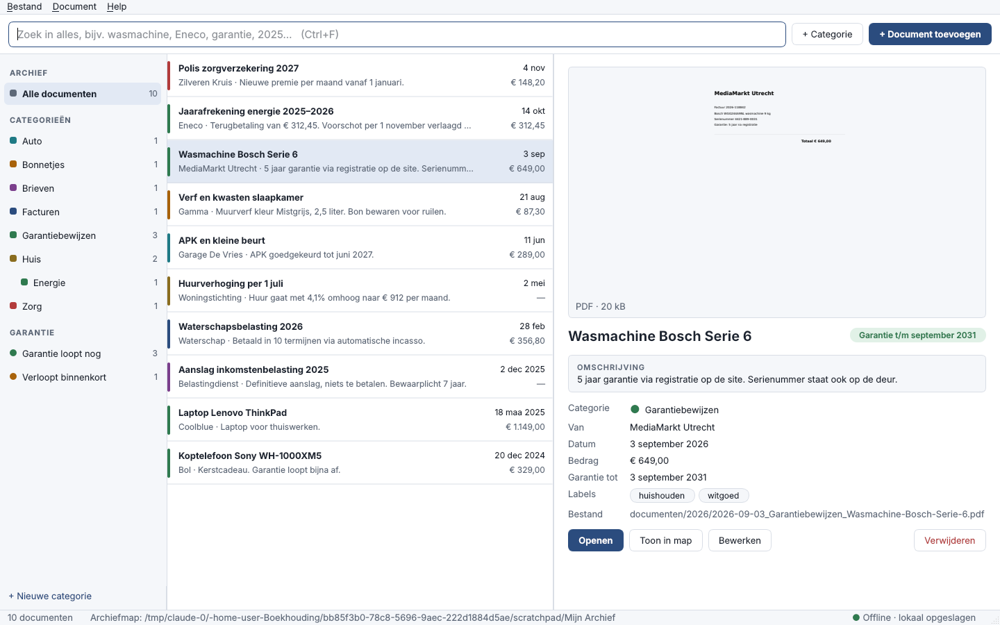

# Mijn Archief

Een eigen digitaal documentenarchief voor Windows. Bonnetjes, garantiebewijzen, facturen en brieven
worden overzichtelijk en doorzoekbaar op je eigen computer bewaard.



## Wat kan het?

- **Volledig offline.** Het programma maakt nooit verbinding met internet. Er is geen account en geen cloud.
  Een automatische test controleert dat de code geen netwerkfuncties gebruikt.
- **Alles lokaal.** Je documenten staan als gewone bestanden in één map op je computer, netjes per jaar en met
  een duidelijke naam. Ook zonder het programma blijven ze leesbaar.
- **Snel zoeken.** Je kunt zoeken op titel, omschrijving, afzender, labels, categorie, datum, maand,
  jaartal en bedrag, en op de tekst ín PDF-bestanden. Je hoeft woorden niet af te typen: `wasm` vindt
  *wasmachine*. Accenten maken niet uit: `cafe` vindt *café*.
- **Eigen categorieën.** Je kiest zelf de naam, kleur en omschrijving, en je kunt subcategorieën maken
  (bijv. *Huis › Energie*). Bonnetjes, Garantiebewijzen, Facturen en Brieven staan er al in; die kun je
  ook aanpassen of verwijderen.
- **Omschrijvingen en labels** bij elk document, in je eigen woorden.
- **Garanties bijhouden.** Elk document met garantie krijgt een groen, oranje of rood label. In de zijbalk
  zie je meteen welke garanties binnen 3 maanden verlopen.
- **Voorbeeld** van PDF's en foto's direct in het programma.
- **Slepen en neerzetten.** Sleep bestanden naar het venster om ze toe te voegen.
- **Back-up** van je hele archief in één zip-bestand (menu *Bestand › Back-up maken*).
- **Veilig verwijderen.** Een verwijderd document gaat naar de map `prullenbak` in je archief, zodat je het
  altijd nog terug kunt halen.

## Installeren op Windows

### Manier 1: installatieprogramma (aanbevolen)

1. Ga op GitHub naar het tabblad **Actions** en open de bovenste groene run van
   *Windows-programma bouwen*. Bij een uitgebrachte versie kan dat ook via **Releases**.
2. Download onder *Artifacts* het bestand **Mijn-Archief-Windows** en pak het uit.
3. Start `MijnArchief-Setup-….exe`. Je hebt geen beheerdersrechten nodig.
4. Windows kan de melding *"Windows heeft uw pc beschermd"* tonen, omdat het programma niet digitaal is
   ondertekend. Klik dan op **Meer informatie** en daarna op **Toch uitvoeren**.

Wil je niets installeren? Gebruik dan `MijnArchief-zonder-installatie.zip`, pak het uit en start
`MijnArchief.exe`.

### Manier 2: vanuit de broncode

1. Installeer eenmalig [Python 3](https://www.python.org/downloads/) en vink daarbij
   *Add python.exe to PATH* aan.
2. Dubbelklik op `start-windows.bat`. Alleen de eerste keer worden de onderdelen gedownload; daarna werkt
   alles offline.

## Eerste keer starten

Het programma vraagt waar je archief moet komen. Standaard is dat `Documenten\Mijn Archief`. Je kunt ook
een map op een externe schijf kiezen. Daarna kun je meteen documenten toevoegen.

```
Mijn Archief\
├── archief.db             categorieën, omschrijvingen en zoekindex
├── documenten\
│   ├── 2026\
│   │   ├── 2026-09-03_Garantiebewijzen_Wasmachine-Bosch-Serie-6.pdf
│   │   └── 2026-08-21_Bonnetjes_Verf-en-kwasten-slaapkamer.jpg
│   └── 2025\
└── prullenbak\            verwijderde documenten
```

## Sneltoetsen

| Toets | Actie |
|---|---|
| Ctrl+N | Document toevoegen |
| Ctrl+Shift+N | Nieuwe categorie |
| Ctrl+F | Zoeken |
| Esc | Zoekveld leegmaken |
| Ctrl+O of dubbelklik | Document openen |
| Ctrl+E | Document bewerken |
| Delete | Document verwijderen |
| Ctrl+B | Back-up maken |

Klik met de rechtermuisknop op een categorie om die te bewerken, er een subcategorie aan toe te voegen of
hem te verwijderen.

## Zoeken in foto's en scans (optioneel)

PDF's met tekst zijn altijd doorzoekbaar. Wil je ook zoeken op tekst in **foto's van bonnetjes** en
**gescande PDF's**? Installeer dan het gratis programma
[Tesseract-OCR](https://github.com/UB-Mannheim/tesseract/wiki) en vink tijdens de installatie de taal
*Dutch* aan. Mijn Archief vindt Tesseract daarna vanzelf, ook offline. Onder *Help › Over Mijn Archief*
zie je of het gevonden is.

## Back-up en terugzetten

- **Back-up maken:** kies *Bestand › Back-up maken* en sla het zip-bestand op een USB-stick of externe
  schijf op. Je kunt ook de hele map *Mijn Archief* kopiëren.
- **Terugzetten:** pak het zip-bestand uit en kies die map via *Bestand › Ander archief openen*.

## Voor ontwikkelaars

```
pip install -r requirements.txt pytest
python -m pytest            # tests (de venstertests draaien ook zonder scherm)
python main.py              # programma starten
```

- `mijnarchief/archive.py`: opslag, database (SQLite met FTS5-zoekindex), categorieën en back-up
- `mijnarchief/extract.py`: tekst uit PDF's halen (pypdf) en optioneel OCR via Tesseract
- `mijnarchief/ui/`: de vensters (PySide6/Qt)
- `.github/workflows/windows.yml`: bouwt bij elke push de Windows-versie (PyInstaller en Inno Setup).
  Een tag als `v1.0.0` maakt er ook een release van.
- `voorbeelden/`: de oorspronkelijke ontwerpvoorstellen en schermafbeeldingen
